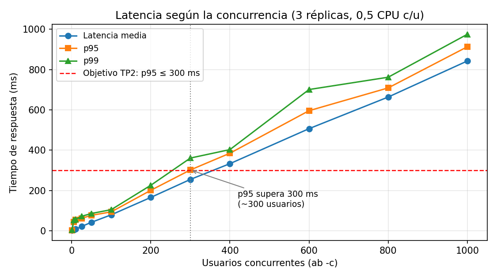
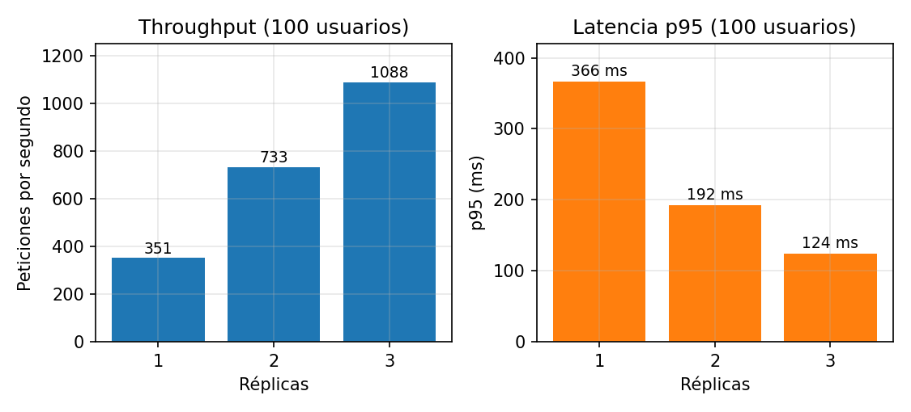
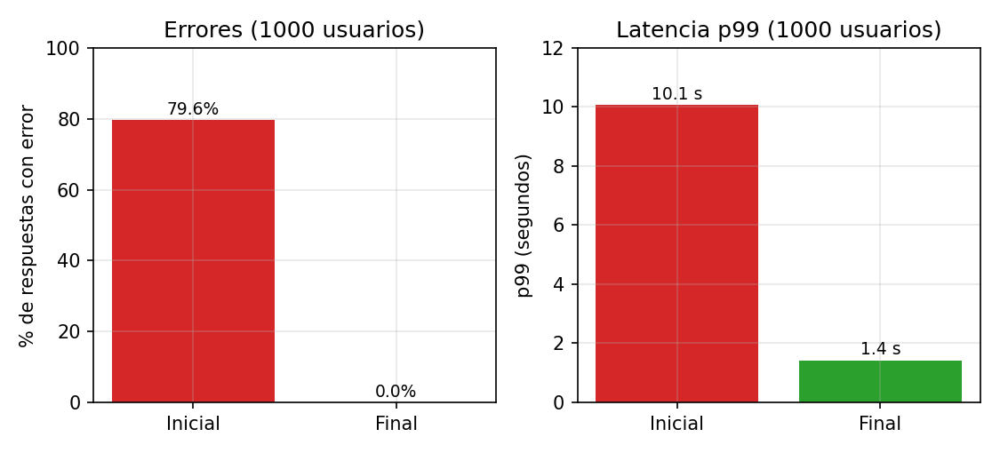

# GlobalLogistics S.A. – Despliegue Cloud-Native (TP3)

Trabajo Práctico N° 3 de **Arquitectura de Sistemas** (Universidad Champagnat, Lic. en Sistemas de Información, ciclo 2026).

**Integrantes:** Arian Nuñez · Ignacio Azzolina · Constantino Mateu
**Docentes:** Prof. Luis Quiroga · Prof. Daniel Garro

Entorno de prueba de la arquitectura distribuida que diseñamos en el TP2: un microservicio de Envíos (API REST en Node.js) corriendo en **3 réplicas** detrás de **1 balanceador de carga NGINX**, todo levantado con Docker Compose como infraestructura como código.

```
                         ┌──────────────────────────────┐
                         │   red interna de Docker      │
  cliente / ab           │                              │
  ───────────► :8080 ──► │  NGINX (gl-balanceador)      │
                         │   least_conn + health check  │
                         │        │      │      │       │
                         │        ▼      ▼      ▼       │
                         │    envios-1 envios-2 envios-3│
                         │   (0,5 CPU c/u, /health)     │
                         └──────────────────────────────┘
```

## Requisitos

- Docker Desktop (o Docker Engine) con Docker Compose v2.
- `curl` para probar a mano.
- Para los scripts de prueba: una terminal con `bash` (macOS, Linux o WSL/Git Bash en Windows). **No hace falta instalar Apache Benchmark**: los scripts lo corren desde la imagen `httpd:2.4-alpine`.

## 1. Levantar el entorno

```bash
git clone https://github.com/Arian1103/GlobalLogistics.git
cd GlobalLogistics
docker compose up -d
```

> La primera vez Compose construye la imagen del microservicio (tarda un minuto). Con la versión vieja de Compose el comando es `docker-compose up -d`. Si se cambia el código, usar `docker compose up -d --build`.

Verificar que quedó **exactamente 1 balanceador y 3 réplicas**, todas `healthy`:

```bash
docker compose ps
```

```
NAME                       IMAGE                        STATUS                   PORTS
gl-balanceador             nginx:1.28-alpine            Up (healthy)             0.0.0.0:8080->80/tcp
globallogistics-envios-1   globallogistics/envios:1.0   Up (healthy)             3000/tcp
globallogistics-envios-2   globallogistics/envios:1.0   Up (healthy)             3000/tcp
globallogistics-envios-3   globallogistics/envios:1.0   Up (healthy)             3000/tcp
```

Para apagar todo: `docker compose down`.

## 2. Probar el balanceo

Cada respuesta incluye el campo `instancia` (el hostname del contenedor, que en Docker es su ID corto) y el header `X-Instancia`:

```bash
curl http://localhost:8080/
./pruebas/balanceo.sh 12      # 12 peticiones seguidas, muestra qué réplica atendió cada una
```

```
  Petición  1  ->  atendida por la instancia e34b3b0cc5bb
  Petición  2  ->  atendida por la instancia 5bacb47dac05
  Petición  3  ->  atendida por la instancia 6fb625ee5fc2
  Petición  4  ->  atendida por la instancia e34b3b0cc5bb
  ...
```

### Endpoints

| Método | Ruta | Qué hace |
|---|---|---|
| GET | `/` | Endpoint principal. Devuelve el hostname / ID del contenedor que respondió. |
| GET | `/health` | Health check (`UP` → 200, `DOWN` → 503). |
| GET | `/cotizar?peso=2&destino=CL` | Cotiza un envío. Hace un cálculo pesado a propósito (~1,4 ms de CPU) para poder saturar la CPU en las pruebas. |
| POST | `/envios` | Alta de envío simulada (pide header `Idempotency-Key`, como en el contrato del TP2). Devuelve 202. |
| POST | `/admin/...` | Solo para las pruebas de resiliencia. El balanceador los bloquea (403); se usan con `docker compose exec`. |

## 3. Health checks

Hay dos niveles:

- **Docker (activo):** cada réplica tiene un `healthcheck` que consulta `/health` cada 5 s. Si falla 3 veces seguidas, el contenedor queda `unhealthy`. El balanceador no arranca hasta que las 3 réplicas están `healthy` (`depends_on: condition: service_healthy`). Si el proceso se cae, `restart: unless-stopped` lo vuelve a levantar.
- **NGINX (pasivo):** `max_fails=3 fail_timeout=5s` en el upstream. Si una réplica rechaza conexiones o devuelve 502/503, NGINX reintenta la petición en otra réplica (`proxy_next_upstream`) y la saca de la rotación durante 5 s. NGINX open source no tiene health checks activos (eso está en NGINX Plus o HAProxy).

Además NGINX usa el DNS interno de Docker con `resolve`, así que si se escala el servicio (`docker compose up -d --scale envios=5`) toma las réplicas nuevas sin reiniciarse.

## 4. Reproducir las pruebas de carga

Todos los scripts dejan la salida completa en `pruebas/resultados/`.

```bash
./pruebas/carga.sh         # Escenario moderado (100 usuarios) y extremo (1000 usuarios)
./pruebas/barrido.sh       # 1, 5, 10, 25 ... 1000 usuarios → barrido.csv
./pruebas/escalado.sh      # misma carga con 1, 2 y 3 réplicas → escalado.csv
./pruebas/resiliencia.sh   # tira una réplica y enferma otra mientras hay carga
```

Si se prefiere correr `ab` instalado en la máquina (contra el puerto publicado):

```bash
# Escenario 1: concurrencia moderada
ab -l -n 20000 -c 100 "http://localhost:8080/cotizar?peso=2&destino=CL"

# Escenario 2: concurrencia extrema (en macOS antes hay que subir el límite de archivos abiertos)
ulimit -n 10240
ab -l -n 50000 -c 1000 "http://localhost:8080/cotizar?peso=2&destino=CL"
```

> `-l` hace que `ab` no cuente como error las respuestas de largo distinto (el JSON trae el tiempo de cálculo, que varía). Los números cambian según la máquina; los nuestros se midieron en una MacBook con Apple M1 y Docker Desktop.

## 5. Resultados obtenidos

Configuración: 3 réplicas con 0,5 CPU cada una, endpoint `/cotizar`.

| Escenario | Peticiones | Usuarios | req/s | Media | p50 | p95 | p99 | Máx. | Errores |
|---|---|---|---|---|---|---|---|---|---|
| Moderado | 20.000 | 100 | 1.085 | 92 ms | 91 ms | 156 ms | 204 ms | 366 ms | 0 |
| Extremo | 50.000 | 1.000 | 1.134 | 882 ms | 845 ms | 1.107 ms | 1.413 ms | 1.590 ms | 0 |



- El throughput se estanca en ~1.150–1.250 req/s a partir de ~10 usuarios: ahí las réplicas ya usan todo su medio núcleo.
- De ahí en adelante la latencia crece en línea recta con la cantidad de usuarios (Ley de Little: latencia ≈ usuarios ÷ throughput).
- El objetivo del TP2 (p95 ≤ 300 ms) se cumple hasta ~300 usuarios concurrentes.
- Con 1, 2 y 3 réplicas el throughput fue 351, 733 y 1.088 req/s: el escalado horizontal es casi lineal.
- En la prueba de resiliencia (una réplica se cae y otra devuelve 503 durante 18 s) las 40.000 peticiones respondieron 200.



### Lo que aprendimos en el camino

La primera versión de `nginx.conf` reutilizaba conexiones con las réplicas (`keepalive`) y contaba los timeouts como fallas. En el escenario extremo algunas peticiones quedaban esperando más de 10 s, NGINX marcó a las tres réplicas como caídas y devolvió **502 al 79,6 % de las peticiones**. Lo explicamos en detalle en el informe; la evidencia está en `pruebas/resultados/v1_config_inicial/` y `pruebas/resultados/diagnostico/`.



## Estructura del repositorio

```
.
├── docker-compose.yml          # IaC: 1 balanceador + 3 réplicas
├── balanceador/nginx.conf      # balanceo least_conn + health checks pasivos + reintentos
├── servicio-envios/            # microservicio (Node.js + Express)
│   ├── Dockerfile
│   ├── package.json / package-lock.json
│   └── src/server.js
├── pruebas/                    # scripts de balanceo, carga, barrido, escalado y resiliencia
│   └── resultados/             # salidas de ab, CSV y muestras de CPU de nuestras corridas
└── docs/
    ├── capturas/               # capturas del navegador y de la terminal
    └── graficos/               # gráficos generados con los CSV
```
